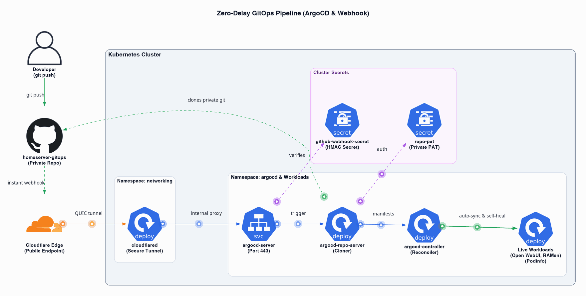

<h1 align="center">Hi 👋, I'm Yasir</h1>
<h3 align="center">Aspiring DevOps Engineer | K8s Enthusiast | Homelabber</h3>

  🌱 Currently learning: <b>Kubernetes and GitOps</b> 
  📫 Reach me directly at: <a href="mailto:aayasir217@gmail.com"><b>aayasir217@gmail.com</b></a>

  
  &nbsp;&nbsp;&nbsp;&nbsp;
  

---

<h3 align="center">My Toolbox</h3>

  

---

<h3 align="center">My Homelab</h3>

  

* **Zero-Delay GitOps**: Webhook-triggered ArgoCD sync reconciling commits in sub-5 seconds.
* **Zero Inbound Ports**: Secure ingress via Cloudflare QUIC tunnel with no router port forwarding.
* **Private Repository Access**: Scoped GitHub PAT in native K8s Secrets for private manifest pulling.
* **Self-Healing Sync**: Automated drift correction and pruning keeping workloads aligned with Git.

